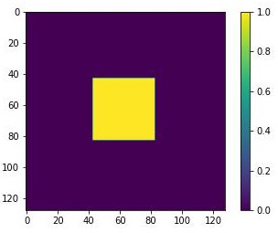

# Modelling the Advection-Diffusion Equation using NN4PDEs

[](https://github.com/Amin-Nadimy/Advection_Diffusion_NN4PDEs/actions/workflows/tests.yml)


This repository presents a novel approach to the discretisation and solution of the advection-diffusion equation using finite difference (FD), finite volume (FV), and finite element methods (FE). This method reformulates the discretised system of equations as a discrete convolution, analogous to a convolutional layer in a neural network, and solves it using The Jacobi and Gauss-Seidel Iterative Methods.

## Key Features:
- **A simple and compact code
- **Platform-Agnostic Code**: Runs seamlessly on CPUs, GPUs, and AI-optimised processors.
- **Neural Network Integration**: Easily integrates with trained neural networks for sub-grid-scale models, surrogate models, or physics-informed approaches.
- **Accelerated Development**: Leverages machine-learning libraries to speed up model development.

## Applications:
- It is a scalable method that runs in serial on CPU and GPU.
- Larger size problems have been run in parallel on 2,4, and 8 GPUs on a local machine and a GPU cluster.

### Domain of the problem
- The domain size is 128 by 128
- The resolution in this case is 1 m in x and y directions.
- 



## Results:


## Tests

The discretisation is also available as an importable module, `nn4pdes_advdiff.py`, with the same filters and time step as the script in `Python Code/`. The tests in `tests/` check the physics of the scheme:

- each stencil annihilates a constant field (no mass created or destroyed),
- the Laplacian stencil returns exactly 2 for f = x²,
- the derivative stencils are exact for linear fields,
- total mass is conserved while the blob is inside the domain,
- the explicit scheme stays finite and bounded at the script's CFL number,
- pure diffusion lowers the peak and widens the blob,
- any grid size works and GPU results match CPU results.

Run them with:

```bash
pip install torch pytest
pytest -q
```

They also run automatically on every push through GitHub Actions (`.github/workflows/tests.yml`).

## Contact and references
For more information please get in touch with me via:
- Email: amin.nadimy19@imperial.ac.uk
